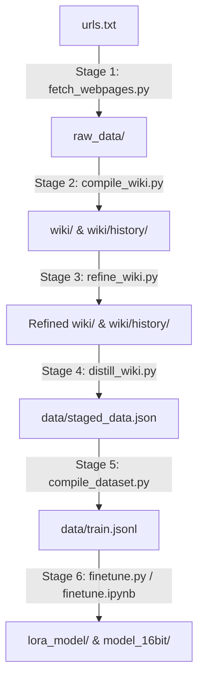

# AI Agent Guide (AGENTS.md)

This document is a guide for AI agents (including Copilot, Antigravity, and other assistant systems) to understand the project architecture, execution flows, known inefficiencies, and codebase bug patterns, enabling highly efficient modifications and execution in the future.

---

## 🚀 1. Pipeline Architecture & Execution Flow

The project implements a **Wiki-First LLM Fine-Tuning Pipeline**. Instead of training on raw crawls, a high-capacity LLM (the "Librarian" hosted locally in LM-Studio) synthesizes raw sources into structured, distraction-free Wiki articles, which are then used to generate high-quality ChatML training pairs.



### Stage Summary & Scripts
1. **Ingest Raw Data** ([fetch_webpages.py](file:///mnt/e/SyncThing/mac-Documents/qspiritguide-unsloth/fetch_webpages.py)): Fetches URLs from `urls.txt` to `raw_data/` as Markdown via `trafilatura` and comments them out in `urls.txt`.
2. **Compile Wiki** ([compile_wiki.py](file:///mnt/e/SyncThing/mac-Documents/qspiritguide-unsloth/compile_wiki.py)): Synthesizes raw files (PDF, EPUB, MD, TXT) into concepts. Creates `wiki/{concept}.md` (current understanding) and `wiki/history/{concept}.md` (chronological/history).
3. **Refine Wiki** ([refine_wiki.py](file:///mnt/e/SyncThing/mac-Documents/qspiritguide-unsloth/refine_wiki.py)): Uses LLM to identify overlapping concepts and merge them to avoid redundancy.
4. **Distill Training Pairs** ([distill_wiki.py](file:///mnt/e/SyncThing/mac-Documents/qspiritguide-unsloth/distill_wiki.py)): Uses LLM to extract 5-10 high-quality instruction-response pairs from `wiki/*.md` into `data/staged_data.json`.
5. **Compile Dataset** ([compile_dataset.py](file:///mnt/e/SyncThing/mac-Documents/qspiritguide-unsloth/compile_dataset.py)): Formats non-flagged staged pairs into ChatML-compliant line-by-line JSONL at `data/train.jsonl`.
6. **Fine-Tuning** ([finetune.py](file:///mnt/e/SyncThing/mac-Documents/qspiritguide-unsloth/finetune.py)): Fine-tunes `unsloth/Qwen2.5-0.5B` locally (uses `mlx-tune` on Darwin/macOS and `unsloth` on Linux).

---

## 📁 2. Directory Structure & State Files

- **`raw_data/`**: Source files (txt, md, pdf, epub).
- **`wiki/`**: Compiled "Current Understanding" articles. Used for Stage 4 distillation.
- **`wiki/history/`**: Historical and evolutionary contexts. Excluded from distillation.
- **`wiki/ignore/`** & **`wiki/history/ignore/`**: Folders for ignored concepts (managed via `manage_ignore.py`).
- **`data/staged_data.json`**: Buffered Q&A pairs (includes `requires_review` and `review_reason` flags).
- **`data/train.jsonl`**: Synthesized ChatML data for direct training ingestion.
- **`.wiki_state.json`**: Map of `{ "filename": "md5_hash" }` for tracking processed files in Stage 2.

---

## ⚠️ 3. Known Inefficiencies & Bugs in the Codebase

When editing or debugging the codebase, be aware of the following issues:

### 3.1. History Directory Bug in `refine_wiki.py`
* **File**: `refine_wiki.py` (lines 121-122)
* **Problem**: When merging secondary concepts into primary ones, the script looks for history files in `wiki/` (e.g. `wiki/history_{concept}.md`) instead of `wiki/history/{concept}.md`.
* **Code snippet**:
  ```python
  primary_hist = os.path.join(WIKI_DIR, f"history_{primary}")
  secondary_hist = os.path.join(WIKI_DIR, f"history_{secondary}")
  ```
* **Impact**: History files are never merged or cleaned up during concept refinement, leading to orphan history files inside `wiki/history/`.
* **Fix**: Change paths to point to `wiki/history/{concept}.md`:
  ```python
  HISTORY_DIR = os.path.join(WIKI_DIR, "history")
  primary_hist = os.path.join(HISTORY_DIR, primary)
  secondary_hist = os.path.join(HISTORY_DIR, secondary)
  ```

### 3.2. Single-File Halt in `compile_wiki.py`
* **File**: `compile_wiki.py` (line 287)
* **Problem**: The script halts using `return` after processing exactly *one* new file.
* **Impact**: If a user uploads 10 new raw files, they must run `python compile_wiki.py` 10 separate times. This makes automated multi-file ingestion very slow and requires manual intervention.
* **Fix**: Support a `--all` CLI flag or remove the hardcoded return statement if a batch execution mode is desired.

### 3.3. Non-Idempotent Appending in `compile_dataset.py`
* **File**: `compile_dataset.py` (line 24)
* **Problem**: `data/train.jsonl` is opened in append mode (`"a"`).
* **Impact**: If the user runs `compile_dataset.py` multiple times, all staging records are repeatedly appended to the dataset, creating massive numbers of duplicate training pairs.
* **Fix**: Open the file in write mode (`"w"`) to overwrite it and ensure idempotency since `data/staged_data.json` is the source of truth.

### 3.4. No Incremental/State Tracking in `distill_wiki.py`
* **File**: `distill_wiki.py`
* **Problem**: The script lacks any form of caching or state tracking (like `.wiki_state.json`). It processes *every* single file in `wiki/` on every execution.
* **Impact**: Re-running distillation after updating or adding a single wiki file triggers expensive, slow LLM calls for the entire knowledge base.
* **Fix**: Implement a `.distill_state.json` file or check `staged_data.json` to skip already distilled wiki concepts.

### 3.5. Notebook out-of-sync with Pipeline Logic
* **Files**: `distill.py` vs `distill_wiki.py`
* **Problem**: `distill.ipynb` is compiled from `distill.py`, which is configured to chunk raw documents from `raw_data/` and includes conflict-aware prompting. However, the production pipeline runs `distill_wiki.py`, which operates directly on the unchunked synthesized `wiki/` documents and has a different prompt.
* **Impact**: Experimenting in `distill.ipynb` does not match the prompt or data-flow logic of the CLI pipeline script (`distill_wiki.py`).
* **Fix**: Standardize `create_distill_notebook.py` to extract code from `distill_wiki.py` or align their processing logic.

### 3.6. Incremental URL Updates in `fetch_webpages.py` (Design Decision)
* **File**: `fetch_webpages.py` (line 65)
* **Feature**: The `comment_out_line` function opens, reads, and writes `urls.txt` repeatedly inside the download loop.
* **Purpose**: This is an intentional crash-resilient design. If the script crashes or is terminated mid-execution, all successfully fetched URLs are already saved as commented out in the URL list, preventing duplicate work on subsequent runs.

### 3.7. Missing `unsloth` Dependency in `pyproject.toml`
* **File**: `pyproject.toml`
* **Problem**: The script `finetune.py` imports `unsloth` on non-Mac (Linux/Windows) systems, but `unsloth` is not specified under `dependencies` or `optional-dependencies`.
* **Fix**: Document this in the installation instructions or add `unsloth` setup instructions in `README.md` for GPU machines.

---

## ⚡ 4. Code & Notebook Synchronization Rule

If you modify `finetune.py` or `distill.py`, you **must** regenerate the corresponding Jupyter Notebooks to keep them in sync:
- Run `python create_notebook.py` after editing `finetune.py`.
- Run `python create_distill_notebook.py` after editing `distill.py`.

---

## 💡 5. Recommended Workflow for AI Agents

To optimize your efficiency when implementing features or debugging this codebase:

1. **Verify `config.json`**: Before initiating LLM calls, read `config.json` to ensure the endpoint and context settings are appropriate.
2. **Speed Up Compilations**: Recommend the user to run `python manage_ignore.py ignore <concept>` on heavy or non-essential topics to bypass long processing during testing.
3. **Analyze Staging State**: Always check `data/staged_data.json` before proposing dataset changes to understand the existing schema and review reasons.
